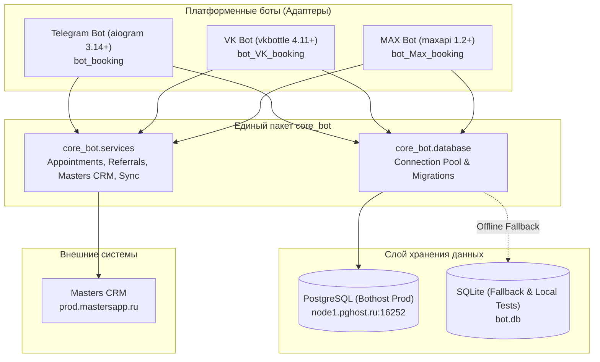

# Архитектура и Документация API Внутренних Сервисов (`core_bot`)

Данный документ описывает архитектуру мультиплатформенной экосистемы ботов онлайн-записи (Telegram, VK, MAX), систему миграций базы данных, внутренние сервисы и контракты API.

---

## 1. Общая архитектура экосистемы

Система построена по модульному принципу: вся бизнес-логика, работа с базой данных, интеграция с Masters CRM и реферальная программа вынесены в единый переиспользуемый пакет **`core_bot`**.
Платформенные боты (`bot_booking`, `bot_VK_booking`, `bot_Max_booking`) выступают тонкими клиентами (адаптерами), отвечающими исключительно за UI, клавиатуры и обработку входящих событий платформ.



### Синхронизация между репозиториями
Для исключения дублирования и расхождения кода используется утилита:
```bash
python3 scripts/sync_core.py
```
Она автоматически обновляет пакет `core_bot`, фасады в `services/` и миграции во всех трёх репозиториях (`bot_booking`, `bot_VK_booking`, `bot_Max_booking`).

---

## 2. Система миграций базы данных (`core_bot.database.migrations`)

### Принцип работы
Вместо тяжёлых внешних ORM (Alembic/SQLAlchemy) используется нативный легковесный dual-engine runner с нулевыми сторонними зависимостями, гарантирующий 100% совместимость с Bothost и локальным SQLite.

Таблица учета примененных версий:
```sql
CREATE TABLE IF NOT EXISTS schema_migrations (
    version VARCHAR(64) PRIMARY KEY,
    name VARCHAR(128) NOT NULL,
    applied_at TIMESTAMP WITH TIME ZONE DEFAULT CURRENT_TIMESTAMP
);
```

### Версии миграций (`core_bot/database/migrations/versions/`)
1. **`001_initial_schema.py`** — создание базовых таблиц `users`, `referrals`, `rewards`, `appointments` и индексов.
2. **`002_masters_session.py`** — создание таблицы `masters_session` для сессий авторизации Masters CRM.
3. **`003_user_roles_and_schedule.py`** — создание таблиц `user_roles` (RBAC) и `master_schedule` (расписание рабочего дня мастера).
4. **`004_data_cleanups.py`** — очистка служебных номеров телефонов мастера из клиентских записей.

### Добавление новой миграции
Создайте файл `core_bot/database/migrations/versions/005_ваше_название.py`:
```python
VERSION = "005_ваше_название"
NAME = "Краткое описание изменений"

def apply(conn):
    if conn.is_pg:
        conn.execute("ALTER TABLE appointments ADD COLUMN notes TEXT;")
    else:
        conn.execute("ALTER TABLE appointments ADD COLUMN notes TEXT;")

def rollback(conn):
    pass
```

### CLI команды
- Просмотр статуса миграций:
  ```bash
  python3 -m core_bot.database.migrations.runner --status
  ```
- Применение ожидающих миграций:
  ```bash
  python3 -m core_bot.database.migrations.runner
  ```

---

## 3. Спецификация API сервисов

### 3.1. `core_bot.services.appointments`
Управляет жизненным циклом записей клиентов, расписанием мастера и рассылкой напоминаний.

#### Таймзона и время
- Все временные метки строго приводятся к **Саратовскому времени (`Europe/Saratov`, UTC+4)**.
- `get_current_saratov_time() -> datetime.datetime`: текущее время в Саратове.
- `parse_to_saratov(val: Any) -> datetime.datetime`: корректно парсит aware и naive ISO-строки (включая UTC `Z` и MSK `+03:00` от Masters CRM), конвертируя через `.astimezone(SARATOV_TZ)`.

#### Основные методы
- `create_or_update_appointment(...) -> int`:
  Создает или обновляет запись. При фоновой синхронизации из Masters CRM сохраняет существующие `platform`, `platform_user_id` и `user_id`. Если телефон пустой, автоматически привязывает запись к клиенту по его `platform_user_id`.
- `cancel_appointment(appointment_id: int) -> tuple[bool, str, dict | None]`:
  Отменяет запись в БД и выполняет синхронизацию отмены с Masters CRM.
- `confirm_appointment_by_client(appointment_id: int) -> tuple[bool, str, dict | None]`:
  Подтверждает запись со стороны клиента (`client_confirmed = True`) и передает статус в Masters CRM.
- `complete_appointment(appointment_id: int) -> tuple[bool, str, dict | None, dict | None]`:
  Переводит запись в статус `completed`. Автоматически начисляет реферальный бонус (300 ₽) пригласившему другу, если это первый выполненный визит.
- `reschedule_appointment(appointment_id: int, new_time: datetime, ...) -> tuple[bool, str, dict | None]`:
  Переносит запись на новую дату/время с гарантированным сохранением таймзоны UTC+4.

#### Расписание мастера и слоты
- `get_master_day_schedule(day_key: str) -> dict`: возвращает статус дня (`is_working`, `start_time`, `end_time`, `note`).
- `set_master_day_schedule(day_key: str, is_working: bool, start_time: str, end_time: str, note: str)`: обновляет график мастера.
- `get_day_time_slots_status(day_key: str) -> dict`: формирует сетку слотов с 08:00 до 21:30 с шагом 30 минут, помечая занятые и свободные часы с учетом наложений процедур.

#### Фоновые напоминания (`reminder_worker`)
- `get_due_evening_reminders(platform: str | None) -> list[dict]`: выборка записей на следующий день для вечернего напоминания (в 19:00).
- `get_due_confirmation_followup_reminders(platform: str | None) -> list[dict]`: выборка неподтвержденных записей для утреннего запроса подтверждения (в 08:30).
- `get_due_2h_reminders(platform: str | None) -> list[dict]`: выборка записей за 2 часа до начала визита. Мастер (`MASTER_USER_IDS` / телефон мастера) гарантированно исключается из рассылки.
- `mark_reminder_sent(appointment_id: int, reminder_type: str)`: атомарная отметка об отправке напоминания.

---

### 3.2. `core_bot.services.referrals`
Единый кроссплатформенный сервис идентификации пользователей, объединения дубликатов и начисления бонусов.

#### Профили и объединение аккаунтов
- `save_user(telegram_id, vk_id, max_user_id, username, first_name, last_name, phone, domain) -> tuple[int, bool]`:
  Сохраняет или обновляет профиль клиента в таблице `users`.
- `link_user_phone(user_identifier: int, phone: str, platform: str) -> tuple[bool, str]`:
  Атомарно привязывает телефон. Если обнаружен существующий профиль (например, созданный ранее при импорте из Masters CRM или другого мессенджера), выполняет безопасное слияние:
  - переносит все записи (`appointments`);
  - переносит реферальные связи (`referrals`);
  - переносит начисленные бонусы (`rewards`);
  - переносит роли доступа (`user_roles`);
  - удаляет дублирующую запись без потери данных.

#### Реферальная программа
- `register_referral(new_user_id, referrer_id, platform="telegram", ...) -> tuple[bool, str, dict | None]`:
  Регистрирует реферальную связь. Поддерживает как позиционные параметры, так и именованные (`new_user_vk_id`, `referrer_telegram_id` и т.д.).
- `mark_referral_visited(referral_id: int) -> tuple[bool, str, dict | None]`:
  Подтверждает визит и начисляет бонус пригласившему (300 ₽).
- `mark_reward_used(reward_id: int) -> tuple[bool, str, dict | None]`:
  Списывает бонус в счет оплаты визита.
- `get_referral_stats(user_id, platform) -> dict`:
  Возвращает статистику приглашений (`started`, `confirmed`, `active_rewards_sum`, `used_rewards_sum`).

#### Роли и безопасность (RBAC)
- `get_user_role(platform_user_id, platform) -> str | None`: возвращает `"admin"`, `"master"` или `None`.
- `is_admin_user(...) -> bool` и `is_master_user(...) -> bool`: проверка прав.
- `assign_user_role(platform_or_user_id, user_id_or_platform, role="master", permissions="all") -> bool`: назначение роли.
- `revoke_user_role(...) -> bool`: отзыв роли.

---

### 3.3. `core_bot.services.masters` и `core_bot.services.masters_sync`
Интеграция с Masters CRM (`prod.mastersapp.ru` и `mst.link`).

- `SERVICES`: единый словарь услуг, их длительности и стоимости.
- `calculate_services(selected_keys) -> dict`: суммирует время и стоимость выбранного набора процедур.
- `get_schedule(selected_keys) -> dict`: обращается к API Masters CRM для получения свободных слотов.
- `initiate_booking(phone, selected_keys, timestamp, client_name="") -> tuple[bool, str, dict | None]`:
  Инициирует процесс бронирования слота в Masters:
  - Защита от самозаписи: блокирует попытки записи на телефон самого мастера (`+79173225155`).
  - **Существующие клиенты CRM (`move_to_url`)**: Masters автоматически распознает зарегистрированных клиентов и перенаправляет на шаг комментария без отправки СМС. Бот автоматически отправляет форму с сохранением имени клиента из CRM, возвращая `session_data["needs_sms"] = False` и `appointment_id`. Клиент записывается мгновенно в 1 клик!
  - **Новые клиенты (`verify_url`)**: Masters отправляет 4-значный СМС-код. Бот возвращает `session_data["needs_sms"] = True` и запрашивает код у пользователя.
- `confirm_sms_code(session_data, code) -> tuple[bool, str]`:
  Подтверждает 4-значный код СМС на странице `/verify`. При редиректе на форму комментария (`/comment`) автоматически финализирует её, извлекая `appointment_id` со страницы подтверждения (`/finish`).
- `sync_masters_appointments() -> tuple[int, int]`:
  Периодический воркер (каждые 15 минут), выгружающий новые и измененные записи из Masters CRM в базу данных ботов с сохранением связей платформ.
- `confirm_masters_appointment`, `cancel_masters_appointment`, `complete_masters_appointment`, `reschedule_masters_appointment`:
  Двусторонняя передача статусов из ботов в Masters CRM через HTTP-запросы.

---

### 3.4. `core_bot.services.client_import`
Массовый импорт базы клиентов.

- `import_clients_from_file(file_path: Path) -> tuple[int, int, list[str]]`:
  Универсальный парсер файлов `.xlsx` (Excel), `.csv` и `.json`. Выполняет валидацию номеров телефонов, дедупликацию и сохранение в таблицу `users`.

---

## 4. Тестирование и гарантии качества

Все тесты изолированы, используют временные базы данных и независимы от внешней сети:
```bash
# Запуск полного набора тестов в Telegram-боте (27 тестов)
bot_booking/.venv/bin/python3 -m unittest discover tests

# Запуск полного набора тестов в VK-боте (27 тестов)
bot_VK_booking/.venv/bin/python3 -m unittest discover tests

# Запуск полного набора тестов в MAX-боте (28 тестов)
bot_Max_booking/.venv/bin/python3 -m unittest discover tests
```

Покрытие включает:
- Проверку точности конвертации часовых поясов (UTC+4);
- Сохранение платформы и идентификатора клиента при синхронизации Masters CRM;
- Корректное объединение профилей с переносом записей, бонусов и ролей;
- Исключение мастера из клиентских напоминаний;
- Идемпотентность и динамическое применение миграций БД;
- Обработку сценариев бронирования: без СМС (`move_to_url`), с подтверждением по СМС и обработку ошибок занятости слотов.
