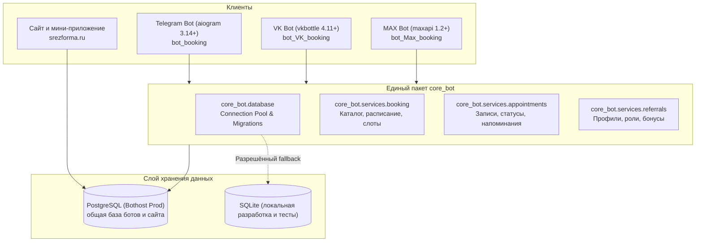

# Архитектура и документация внутренних сервисов (`core_bot`)

Документ описывает мультиплатформенную экосистему онлайн-записи (Telegram, VK, MAX), единую базу данных с сайтом «Срез», систему миграций и контракты внутренних сервисов.

---

## 1. Общая архитектура экосистемы

Вся бизнес-логика, работа с базой данных, расписание, каталог услуг и реферальная программа вынесены в переиспользуемый пакет **`core_bot`**. Платформенные боты (`bot_booking`, `bot_VK_booking`, `bot_Max_booking`) — тонкие адаптеры: UI, клавиатуры и обработка событий платформы. Сайт `srezforma.ru` работает с той же базой и теми же правилами записи.



### Единый источник истины

- **Расписание** хранится в таблице `master_schedule` (переопределения по конкретным датам) и дополняется стандартной сеткой: вторник и суббота, `10:00–19:00`, слоты `10:00, 11:15, 12:30, 14:00, 15:15, 16:30, 17:45`.
- **Каталог услуг** задан в `core_bot/services/booking.py` и используется ботами и сайтом: `hair` — 2 300 ₽ / 75 мин, `beard` — 700 ₽ / 60 мин, `combo` — 3 000 ₽ / 135 мин.
- **Занятость** проверяется по интервалам с учётом длительности услуги: запись блокирует всё время процедуры, а не только время начала.
- Любая запись, отмена или перенос через бота либо сайт сразу видны всем платформам.

### Синхронизация между репозиториями

```bash
python3 scripts/sync_core.py
```

Утилита обновляет `core_bot`, фасады в `services/` и миграции во всех трёх репозиториях (`bot_booking`, `bot_VK_booking`, `bot_Max_booking`). Общими являются `appointments`, `booking`, `referrals`, `client_import` и `recommendations`.

---

## 2. Система миграций базы данных (`core_bot.database.migrations`)

### Принцип работы

Вместо тяжёлых ORM используется нативный dual-engine runner с поддержкой PostgreSQL и SQLite. Таблица учёта версий:

```sql
CREATE TABLE IF NOT EXISTS schema_migrations (
    version VARCHAR(64) PRIMARY KEY,
    name VARCHAR(128) NOT NULL,
    applied_at TIMESTAMP WITH TIME ZONE DEFAULT CURRENT_TIMESTAMP
);
```

### Отказоустойчивость подключения

- При настроенном `DATABASE_URL` и `ALLOW_SQLITE_FALLBACK=false` недоступность PostgreSQL фатальна: `get_connection()` выбрасывает `RuntimeError` и не переключается молча на локальный SQLite.
- Повторные вызовы после сбоя также завершаются ошибкой (fail-closed), чтобы боты не создавали отдельную локальную базу и split-brain.
- SQLite используется только при явно разрешённом fallback или при отсутствии `DATABASE_URL` (локальная разработка и тесты).

### Версии миграций (`core_bot/database/migrations/versions/`)

1. **`001_initial_schema.py`** — базовые таблицы `users`, `referrals`, `rewards`, `appointments` и индексы.
2. **`003_user_roles_and_schedule.py`** — таблицы `user_roles` (RBAC) и `master_schedule` (переопределения рабочего графика).
3. **`004_data_cleanups.py`** — очистка служебных номеров мастера из клиентских записей. Номера берутся из `MASTER_PHONES`/`MASTER_PHONE`; если переменные не заданы, миграция ничего не меняет.
4. **`006_remove_guessed_placeholders.py`** — историческая заглушка, намеренно ничего не делает и сохраняет цепочку миграций.
5. **`007_client_extra_fields.py`** — дополнительные поля карточки клиента: день рождения, источник регистрации, группа, статистика визитов, соцсети, email, комментарий.
6. **`008_site_sync_cleanup.py`** — приводит схему к единой модели сайта и ботов:
   - переименовывает legacy-поля клиента в нейтральные (`source_registered`, `client_group`, `visits_total`, `cancelled_total`, `revenue_total`, `imported_at`), сохраняя данные;
   - добавляет и заполняет `appointments.duration_min` и `appointments.notes`;
   - удаляет устаревшую таблицу сессий и колонку внешнего идентификатора;
   - переводит исторические записи внешней CRM в `platform = 'manual'`;
   - идемпотентна для PostgreSQL и SQLite.

### Добавление новой миграции

Создайте файл `core_bot/database/migrations/versions/009_ваше_название.py`:

```python
VERSION = "009_ваше_название"
NAME = "Краткое описание изменений"

def apply(conn):
    conn.execute("ALTER TABLE appointments ADD COLUMN example TEXT")

def rollback(conn):
    pass
```

### CLI

```bash
python3 -m core_bot.database.migrations.runner --status
python3 -m core_bot.database.migrations.runner
```

---

## 3. Спецификация API сервисов

### 3.1. `core_bot.services.booking`

Единые правила каталога, расписания и доступности слотов. Используется ботами, сайтом и локальным dev-сервером.

#### Каталог услуг

- `SERVICES` — словарь услуг с ценой и длительностью.
- `calculate_services(selected_keys) -> dict` — нормализует набор услуг, суммирует стоимость и время, возвращает `names`, `total_price`, `duration_minutes`, `duration_text`.
- `service_duration_minutes(services: str | None) -> int` — определяет длительность по тексту услуги из записи.
- `map_service_name_to_keys(services: str | None) -> list[str]` — сопоставляет свободное название услуги с ключами каталога.
- `get_service_options_for_creation() -> list[dict]` — варианты услуг для админского создания записи.

#### Расписание и доступность

- `get_day_schedule(day_key: str) -> dict` — эффективный график дня: `is_working`, `start_time`, `end_time`; учитывает `master_schedule`, иначе стандартный вторник/суббота.
- `get_days_schedule(selected_keys=None, days_count=14) -> list[dict]` — календарь на N дней со всеми слотами и флагом `available`. Используется сайтом.
- `get_schedule(selected_keys=None) -> dict` — рабочие дни, в которых есть хотя бы одно свободное окно (вид для клавиатуры бота).
- `is_slot_available(day_key, time, selected_keys=None, exclude_appointment_id=None) -> bool` — проверка слота с учётом рабочих часов, прошедшего времени и наложений.
- `find_overlapping_appointment(conn, start, duration_min, exclude_appointment_id=None) -> dict | None` — поиск пересекающейся записи.
- `get_day_time_slots_status(day_key: str) -> dict` — сетка слотов для админского экрана с пометкой занятости.

---

### 3.2. `core_bot.services.appointments`

Жизненный цикл записей, расписание, ручные записи и напоминания.

#### Таймзона и время

- Все временные метки приводятся к **Саратову (`Europe/Saratov`, UTC+4)**.
- `get_current_saratov_time() -> datetime.datetime` — текущее время в Саратове.
- `parse_to_saratov(val) -> datetime.datetime` — парсит aware/naive ISO-строки и приводит к саратовскому времени.

#### Основные методы

- `create_or_update_appointment(...) -> int`:
  Создаёт или обновляет запись. При повторной отправке того же клиента на тот же слот возвращает существующую запись (идемпотентность). Завершённые визиты не переоткрываются. При пересечении интервалов выбрасывает `SlotUnavailableError`.
- `cancel_appointment(appointment_id, platform=None, platform_user_id=None) -> tuple[bool, str, dict | None]`:
  Отменяет запись и освобождает слот для всех платформ.
- `confirm_appointment_by_client(appointment_id) -> tuple[bool, str, dict | None]`:
  Подтверждает запись клиентом (`client_confirmed = true`).
- `complete_appointment(appointment_id) -> tuple[bool, str, dict | None, dict | None]`:
  Переводит запись в `completed`. При первом завершённом визите начисляет реферальный бонус пригласившему.
- `reschedule_appointment(appointment_id, new_datetime, ...) -> tuple[bool, str, dict | None]`:
  Переносит запись с проверкой рабочих часов и пересечений; текущая запись исключается из проверки.
- `create_manual_appointment(...) -> tuple[bool, str, int | None]`:
  Создаёт запись мастера/администратора с проверкой занятости и длительности.

#### Контроль доступа

- Клиентские операции (отмена, подтверждение, перенос) проверяют `platform` и `platform_user_id`.
- Связь по `user_id` используется только как fallback для записей без платформенного идентификатора; это исключает IDOR после привязки телефона.
- Мастер и администраторы проходят проверку через `is_master_user()` / `is_admin_user()`.

#### Расписание мастера

- `get_master_day_schedule(day_key) -> dict`
- `set_master_day_schedule(day_key, is_working, start_time, end_time, note)`
- `adjust_master_day_hours(day_key, start_time, end_time)` — быстрое изменение часов.
- `get_upcoming_days_schedule(days_ahead=14) -> list[dict]` — сводка ближайших дней для админки.

#### Фоновые напоминания (`reminder_worker`)

- `get_due_evening_reminders(platform=None)` — записи на следующий день (вечернее напоминание).
- `get_due_confirmation_followup_reminders(platform=None)` — неподтверждённые записи для утреннего запроса.
- `get_due_2h_reminders(platform=None)` — напоминание за 2 часа; мастер исключается.
- `get_due_retention_reminders(platform=None)` — удержание только по завершённым визитам (`status = 'completed'`).
- `mark_reminder_sent(appointment_id, reminder_type)` — атомарная отметка отправки.

---

### 3.3. `core_bot.services.referrals`

Кроссплатформенные профили, привязка телефона, роли и бонусы.

#### Профили

- `save_user(telegram_id, vk_id, max_user_id, username, first_name, last_name, phone, domain)` — создаёт или обновляет клиента.
- `link_user_phone(user_identifier, phone, platform)` — привязывает номер к текущему профилю. Автоматическое слияние профилей по телефону запрещено: при конфликте возвращается предупреждение, оба профиля остаются неизменными.
- `is_master_phone(phone)` — проверка номера по `MASTER_PHONES`/`MASTER_PHONE`.

#### Реферальная программа

- `register_referral(new_user_id, referrer_id, platform="telegram", ...)` — регистрирует связь.
- `mark_referral_visited(referral_id)` — подтверждает визит и начисляет бонус пригласившему.
- `mark_reward_used(reward_id)` — списывает бонус.
- `get_referral_stats(user_id, platform)` — статистика приглашений и бонусов.

#### Роли и безопасность (RBAC)

- `get_user_role(platform_user_id, platform)`
- `is_admin_user(...)`, `is_master_user(...)`
- `assign_user_role(...)`, `revoke_user_role(...)`

---

### 3.4. `core_bot.services.client_import`

Массовый импорт клиентов из `.csv`, `.xlsx` и текста.

- `import_clients_from_file(filename, file_bytes) -> tuple[int, int, str]` — определяет формат, валидирует телефоны, дедуплицирует и сохраняет клиентов.
- `import_clients_from_text(raw_text) -> tuple[int, int, str]` — импорт из строк «Имя + телефон».
- `import_clients_from_rows(rows) -> tuple[int, int, str]` — общая обработка таблиц.
- `get_clients_stats()`, `get_clients_page(...)` — статистика и постраничный список клиентов для админки.
- `update_appointment_client_details(appointment_id, name, phone)` — обновление контактов в записи.

---

### 3.5. Сайт «Срез» (`hair_site`)

Сайт использует те же правила, что и боты, через общий PostgreSQL.

| Endpoint | Назначение |
| --- | --- |
| `GET /api/slots?services=hair,beard` | 14 дней с расписанием и доступностью слотов; учитывает `master_schedule`, длительность услуг и занятые интервалы. |
| `POST /api/appointments` | Создание записи с проверкой рабочих часов и пересечений под advisory-lock; возвращает `409`, если слот занят. |
| `GET /api/crm/appointments` | Список записей для CRM с `duration_min` и `notes`. |
| `POST /api/crm/appointments` | Ручная запись мастера с теми же проверками. |

Уведомления мастеру отправляются через Telegram Bot API при наличии `TELEGRAM_BOT_TOKEN` и `MASTER_CHAT_IDS`. Секреты и строка подключения берутся только из переменных окружения.

---

## 4. Тестирование и гарантии качества

Все тесты изолированы, используют временные базы данных и не требуют сети:

```bash
# Telegram
bot_booking/.venv/bin/python3 -m unittest discover tests

# VK
bot_VK_booking/.venv/bin/python3 -m unittest discover tests

# MAX
bot_Max_booking/.venv/bin/python3 -m unittest discover tests
```

Покрытие включает:

- конвертацию часовых поясов (UTC+4);
- единый каталог услуг, длительности и стоимости;
- расписание из `master_schedule` и стандартную сетку вторник/суббота;
- запрет пересекающихся записей с учётом длительности услуги;
- идемпотентность повторной записи и сохранение завершённых визитов;
- изоляцию профилей при конфликте телефона (без автоматического слияния);
- защиту от IDOR: клиент не управляет чужой записью;
- fail-closed поведение при недоступном PostgreSQL;
- исключение мастера из клиентских напоминаний;
- retention-рассылку только по завершённым визитам;
- идемпотентность и динамическое применение миграций;
- сценарии бронирования без SMS и обработку занятых слотов.
